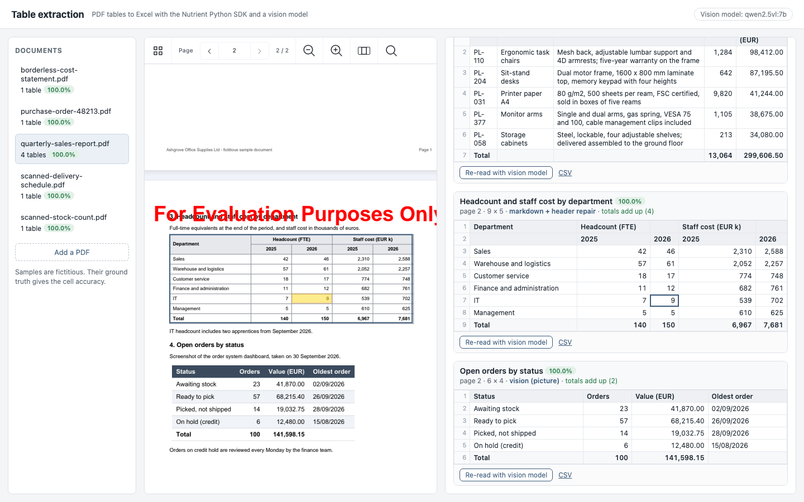
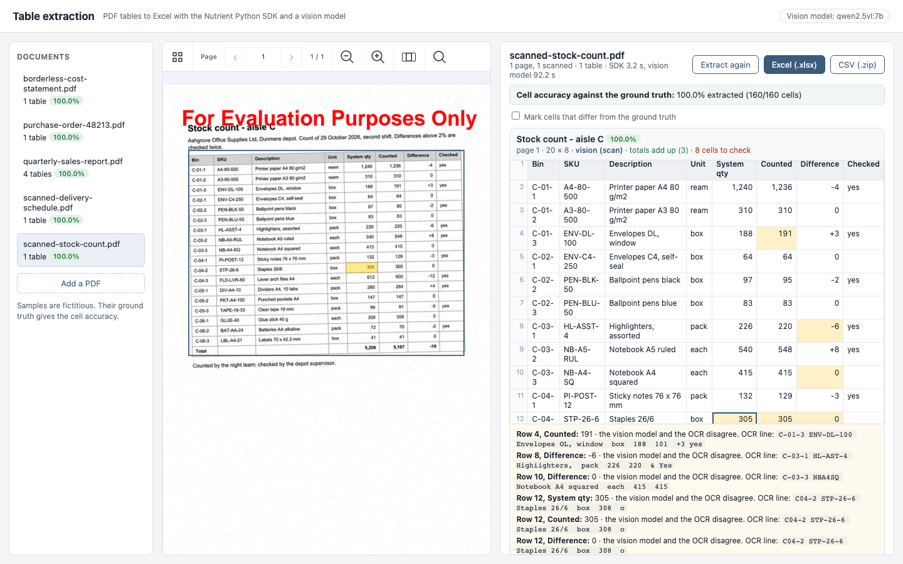
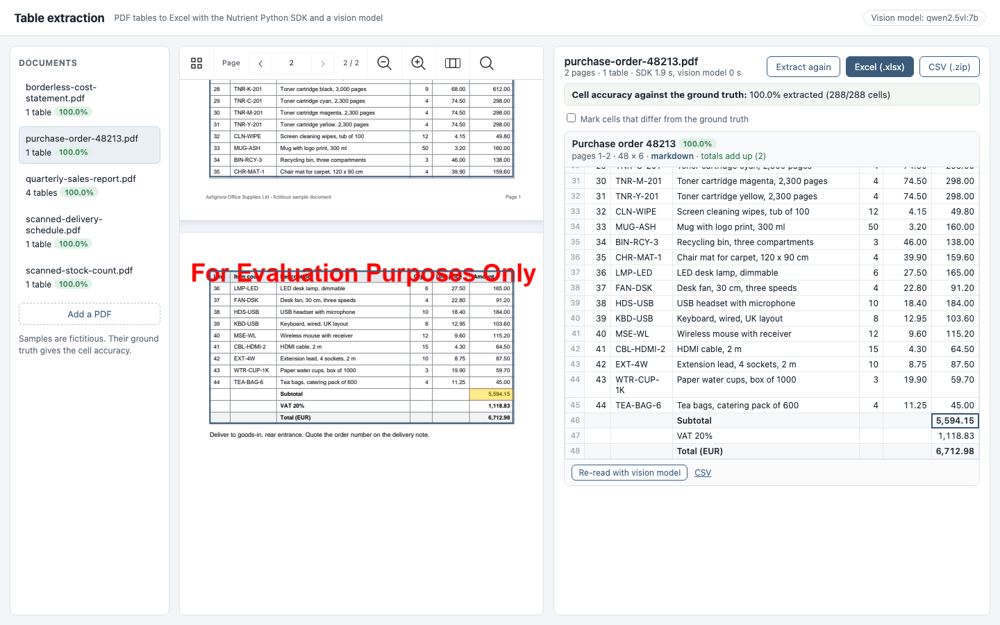

# Nutrient Table Extraction

A Nutrient.io demo that extracts the tables of PDF reports, scans and pasted pictures into Excel with the Nutrient Python SDK and a local vision model, shows each table next to its page with click-to-highlight, and lets you correct a cell before the export.



1. **Export.** The Nutrient Python SDK exports each PDF as Markdown with a marker at the start of each page and the tables as HTML (`colspan`, `rowspan`, `<br/>` inside a cell). The HTML export in page layout gives the position of every table and picture on its page, and the SDK renders each page to PNG.
2. **Text tables.** Every `<table>` of the Markdown becomes a grid of cells. Two fixes follow:
   - a two-level header that the export squeezed into one merged cell ("Headcount (FTE)" over "2025 2026") is split back into two header rows;
   - a table that ends a page and continues on the next one (same columns, repeated header or none) is joined, and the repeated header is dropped.
3. **Scans and pictures.** A page without a text layer is a scan: the SDK runs OCR on it in memory (`PdfEditor.make_searchable()`), which locates the table, and the vision model reads the table from the page image. A picture on a text page (a pasted screenshot of a table) is cropped and read by the vision model too. On scans, every number the model read is compared with the SDK's OCR text of the same row; when the two disagree, the cell is flagged.
4. **Totals check.** Each total or subtotal row is compared with the sum of the rows above it (or of the subtotals, or subtotal plus VAT). A total that does not add up is flagged.
5. **Locate.** Inside each table position, the ruling lines (or the white gaps) of the page image give the rows and columns, so a click on a cell highlights it on the page. Scans are straightened first.
6. **Review and export.** Each table shows next to its page in the Nutrient Web SDK viewer. Edit any cell; the totals check runs again. Download one Excel workbook with one sheet per table (numbers as numbers, merged header cells, total rows in bold) or the tables as CSV.

## Prerequisites

- Python 3.11 or later (tested with 3.13)
- macOS on Apple Silicon, Linux x64 or Windows x64 (the Nutrient Python SDK native runtimes). Tested on macOS on Apple Silicon.
- [Ollama](https://ollama.com/download) with `qwen2.5vl:7b` (6 GB, 16 GB RAM recommended), or any OpenAI-compatible endpoint with a vision model
- Disk space for the OCR models that the SDK downloads to `~/.local/share/Nutrient` the first time it reads a scan
- A browser with internet access: the viewer loads the Nutrient Web SDK 1.24.0 from `https://cdn.cloud.pspdfkit.com/pspdfkit-web@1.24.0/`

## Environment variables

Keys are only read from environment variables, never from code. Start from `.env.example`.

| Variable | Purpose | Default |
|---|---|---|
| `NUTRIENT_LICENSE_KEY` | Nutrient Python SDK license key | empty = evaluation mode |
| `NUTRIENT_WEB_SDK_LICENSE_KEY` | Nutrient Web SDK license key, served to the browser by `GET /api/config` | empty = evaluation mode |
| `VISION_BASE_URL` | OpenAI-compatible endpoint of the vision model | `http://localhost:11434/v1` |
| `VISION_MODEL` | Vision model that reads scans and pictures | `qwen2.5vl:7b` |
| `VISION_API_KEY` | API key of that endpoint | empty (Ollama needs none) |
| `VISION_TIMEOUT` | Seconds to wait for one answer | `600` |
| `RENDER_DPI` | Resolution of the page images | `150` |
| `DOCUMENTS_FOLDER` | Sample documents | `samples/documents` |
| `OUTPUT_FOLDER` | Results, page images and uploaded PDFs | `output` |
| `HOST`, `PORT` | Address of the web page | `127.0.0.1`, `4730` |

## Build and run

```bash
python3 -m venv .venv
```

```bash
.venv/bin/pip install -r requirements.txt
```

```bash
ollama pull qwen2.5vl:7b
```

```bash
.venv/bin/python server.py
```

Open <http://localhost:4730>. To use the values from `.env`, load them first with `set -a && source .env && set +a`. On Windows, use `.venv\Scripts\python`.

The SDK work for each document runs in a new worker process, so the one-hour limit of an evaluation session never stops the server.

## Using the app

1. Pick a document on the left and click **Extract tables**. Text tables take one or two seconds; each scanned page or picture adds one call to the vision model (under a minute to a few minutes on a laptop, depending on the load of the model).
2. Each table is a card: title, pages, size, how it was read (`markdown`, `markdown + header repair`, `vision (scan)`, `vision (picture)`), the totals check and the cells to check.
3. Click a card title to outline the table on the page, or a cell to highlight that cell. Type to correct a cell; **Enter** saves it.
4. Flagged cells are yellow, with the reason listed under the table: a total that does not add up, or a number on which the vision model and the OCR disagree (the OCR line is shown).

   

5. For the samples, the green bar gives the cell accuracy against the ground truth, before and after your corrections. **Mark cells that differ from the ground truth** outlines the wrong cells.
6. **Re-read with vision model** reads any table again from its region of the page image, to compare; **Back to ...** restores the previous reading.
7. **Excel (.xlsx)** downloads one sheet per table; **CSV (.zip)** one CSV per table. **Add a PDF** extracts your own document.

   

## API

| Method and path | Description |
|---|---|
| `GET /api/config` | `{ web_sdk_license_key, vision_model }` |
| `GET /api/documents` | Sample and uploaded PDFs, with the number of tables and the accuracy |
| `POST /api/documents?name=x.pdf` | Raw PDF body. Adds a document |
| `POST /api/documents/{id}/extract` | Starts the extraction in the background |
| `GET /api/documents/{id}` | Progress, result (tables, cells, positions, checks, flags) and accuracy |
| `PUT /api/documents/{id}/tables/{n}` | `{ rows }`: saves corrected cells (same rows and columns) |
| `POST /api/documents/{id}/tables/{n}/vision` | Reads the table again with the vision model |
| `POST /api/documents/{id}/tables/{n}/revert` | Restores the reading before the last vision re-read |
| `GET /api/documents/{id}/tables.xlsx` | Excel workbook, one sheet per table |
| `GET /api/documents/{id}/tables.zip` | One CSV per table |
| `GET /api/documents/{id}/tables/{n}.csv` | One table as CSV |

## Evaluation

```bash
.venv/bin/python evaluate.py --fresh
```

The script extracts the five sample documents and compares every cell with `samples/ground-truth.json` (rows are aligned first, so one missing row does not shift the whole table). It also scores the tables of the Markdown export as they come, without the header repair, the page stitching and the vision model. The result is written to `output/evaluation.json`.

Result with `qwen2.5vl:7b` on Ollama, Nutrient Python SDK 1.0.13 in evaluation mode, on an Apple Silicon laptop:

| Table | Read by | Cells | Markdown export alone |
|---|---|---|---|
| Sales by region (simple, totals row) | markdown | 35/35 | 35/35 |
| Top product lines (cells on two lines) | markdown | 35/35 | 35/35 |
| Headcount and staff cost (two-level header, merged cells) | markdown + header repair | 45/45 | 38/45 |
| Open orders by status (table pasted as a picture) | vision (picture) | 24/24 | not found |
| Order lines (one table on two pages, subtotal, VAT, total) | markdown, joined | 288/288 | 216/288 (page 1 only) |
| Project cost statement (no ruling lines, indented items, subtotals) | markdown | 64/64 | 64/64 |
| Delivery schedule (scan, 200 dpi) | vision (scan) | 72/72 | not found |
| Stock count (dense scan, 130 dpi, 1.2° skew) | vision (scan) | 160/160 | not found |
| **All** | | **723/723 (100%)** | **390/723 (53.9%)** |

- **Text tables.** The SDK's Markdown export got every cell of the text tables right, including the cells on two lines and the table without ruling lines. The two fixes on top of it are deterministic: the header split and the join of the table across pages.
- **Vision model.** The delivery schedule (four runs) and the picture table (five runs) were read correctly in every run made while building the demo. On the dense stock count, the first of three runs returned the total row shifted by one empty cell; the app now drops the extra blank of a row longer than the header, and the totals check flags such a shift. The two later runs were correct.
- **OCR cross-check.** On the two scans, the SDK's OCR (used to place the table) misreads some digits (`101` for `191`, `308` for `305` on the low-resolution scan). Where it disagrees with the vision model, the cell is flagged: 1 cell on the delivery schedule, 8 on the stock count. In these runs, the vision model was right every time.
- **Re-read.** Re-reading the text tables with the vision model gave the same cells for the simple table, and 43/45 on the two-level header (it repeated the merged header text in the covered cells).
- **Time.** About 1 to 4 seconds of SDK work per document. Each call to the vision model took 45 seconds to 3 minutes, with another application using the same Ollama server at the same time.

The samples are clean, generated documents. Real scans (faxes, photos, handwriting, stamps across the table) will give lower numbers; the totals check, the OCR cross-check and the review step are there for that.

## Evaluation mode

The demo runs without license keys. What was used and checked in evaluation mode (Nutrient Python SDK 1.0.13):

| SDK call | Result in evaluation mode |
|---|---|
| `export_as_markdown`, `use_html_tables = True` | Complete tables with `colspan` and line breaks in cells |
| `export_as_html`, `HtmlLayoutType.PAGE_LAYOUT` | Position of every table, picture and text block, in points |
| `export_as_image` | Clean page images, no watermark |
| `PdfEditor.make_searchable()` in memory, then `export_as_text` and `export_as_html` | Complete OCR text and table positions; nothing saved, so no watermark |
| `export_as_spreadsheet` (PDF to Excel) | Works, but a cell on two lines spilled into its neighbours on a test table. Not used |
| `Vision.extract_content()` | About half of the content is replaced by "This content is hidden in trial mode". Not used |

The Web SDK viewer shows an evaluation watermark on the page.

## Samples

`samples/documents` holds five fictitious documents of an office supplies company, generated by `samples/generate_samples.py`, with their ground truth in `samples/ground-truth.json`:

| File | Content |
|---|---|
| `quarterly-sales-report.pdf` | 2 pages: a simple table with a totals row, a table with cells on two lines, a two-level header with merged cells, and a table pasted as a picture |
| `purchase-order-48213.pdf` | 2 pages: 44 order lines in one table that continues on page 2, then subtotal, VAT and total rows |
| `borderless-cost-statement.pdf` | Columns aligned with spaces, no ruling lines, indented items, section subtotals |
| `scanned-delivery-schedule.pdf` | Image only: a printed table rasterised at 200 dpi, slightly rotated, with scan noise |
| `scanned-stock-count.pdf` | Image only: a denser 8-column table, rasterised at 130 dpi, 1.2° skew, more noise |

The scans and the picture are rasterised with the Nutrient Python SDK. To regenerate the samples:

```bash
.venv/bin/pip install -r samples/requirements.txt
```

```bash
.venv/bin/python samples/generate_samples.py
```

## Limitations

- **Models.** Tested with `qwen2.5vl:7b` only. A 7B vision model reads clean printed tables well but can drop or shift cells on dense or merged layouts (see the re-read result above); it does not report a reliable confidence, which is why the app relies on the totals check and the OCR cross-check. A stronger model (a larger Qwen-VL, or a hosted model through `VISION_BASE_URL`, `VISION_MODEL` and `VISION_API_KEY`) should hold merged cells and long tables better and answer much faster; this was not tested here.
- **Text tables.** Only tables that the Markdown export finds are extracted from text pages. The header repair handles a two-level header whose lower level has one word per column. A table is joined across pages when it ends one page and starts the next; a table that continues after other text is not.
- **Pictures.** Every picture on a text page is sent to the vision model; a picture without a table costs one call and is then ignored.
- **Cell highlight.** Cells are located when the rows and columns found on the page image match the table. Otherwise the table is outlined and the row or cell is not.
- **Formats.** PDF only. The SDK converts Word, Excel and images too, but they were not wired in here.
- **Edits.** The rows and columns of a table are fixed: you can correct cells, not add or delete rows.

## Project layout

| Path | Content |
|---|---|
| `server.py` | Starts the web page |
| `app/sdk.py` | Nutrient Python SDK: Markdown, page layout, page images, OCR |
| `app/tables.py` | HTML tables to grids, header repair, page stitching, totals check |
| `app/vision.py` | Vision model calls and the OCR cross-check |
| `app/grid.py` | Rows and columns of a table on the page image, for the highlight |
| `app/pipeline.py` | The extraction of one document |
| `app/export.py` | Excel and CSV |
| `app/accuracy.py`, `evaluate.py` | Cell accuracy against the ground truth |
| `app/main.py`, `web/` | Web API and page |
| `samples` | Fictitious documents, their ground truth and their generator |
